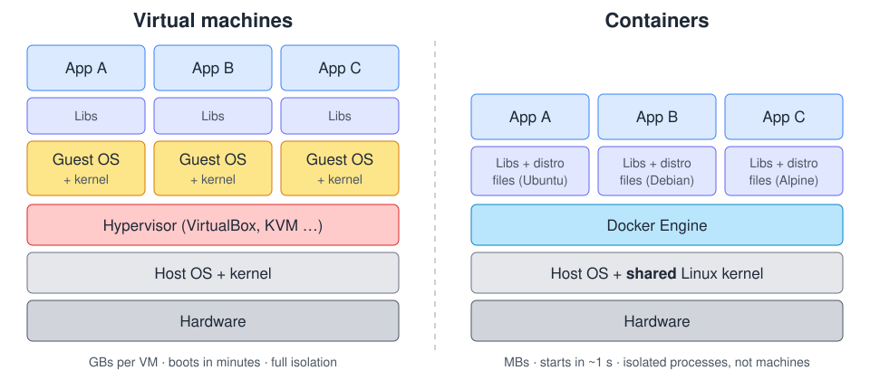
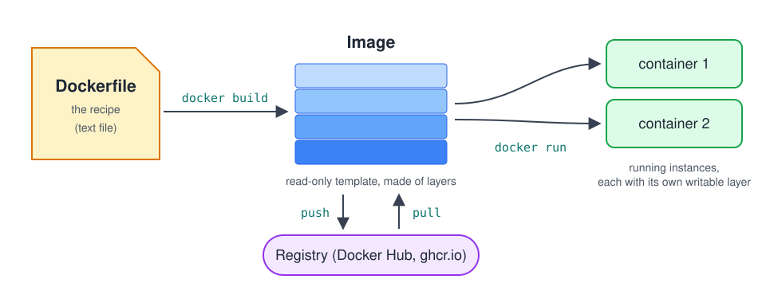
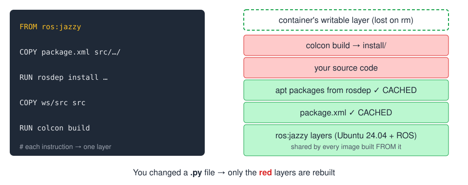
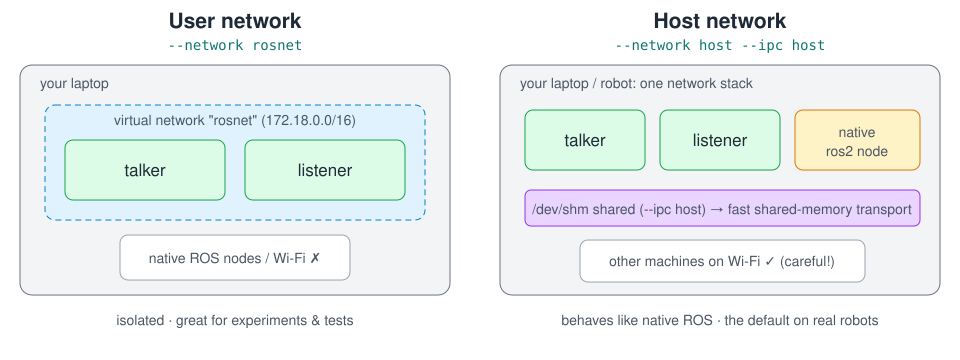

<!-- _class: lead -->
<!-- _paginate: false -->

# 🐳 Docker for Robotics 🤖

### From "works on my machine" to "works on every robot"

ROS 2 Jazzy · hands-on workshop

<!--
Welcome. Plan for today: ~45 min of talk, then exercises with breaks for more theory.
Ask everyone to open the repo and check `./setup/check_setup.sh` ran OK.
Hand out ROS_DOMAIN_IDs now (e.g. seat numbers 1..N).
-->

---

# Before we start

- Repo cloned? `./setup/check_setup.sh` → **All good!** ?
- Your **ROS_DOMAIN_ID** (write it down!):
  ```bash
  export ROS_DOMAIN_ID=<your number>
  ```
- Exercises are in `exercises/01` … `08`. Every one has a README.
- ⭐ **Stretch** = optional. Skip it if you're behind.
- Stuck? Raise your hand. Questions are welcome **anytime**.

<!--
If someone's setup is broken: pair them with a neighbour for now, fix during the first exercise.
USB stick with `docker save` tarballs is the backup for slow Wi-Fi: `docker load -i ros-jazzy.tar`.
-->

---

# Agenda

| | |
|---|---|
| **Part 1** | Why containers? Core concepts. Dockerfiles. Data & networking |
| 🛠️ | Exercises 01–03: Docker basics |
| ☕ | Break |
| **Part 2** | Docker for ROS 2 |
| 🛠️ | Exercises 04–06: ROS 2 in containers, custom images, Compose |
| **Part 3** | GUI tools & hardware |
| 🛠️ | Exercises 07–08: RViz, turtlesim, serial ports, cameras |

---

<!-- _class: divider -->

# Part 1
## Why containers?

---

# Sound familiar? 😩

- *"It works on my laptop!"* …but not on yours, and not on the robot.
- The robot runs **Ubuntu 22.04 + Humble**, your laptop has **24.04**, and Jazzy needs 24.04.
- *"Just install these 37 packages… oh, and this specific OpenCV version… and build that library from source."*
- A new club member spends **their first two weeks** just setting up the environment.
- Someone ran `sudo pip install` and now `apt` is broken.
- *"Which version of the code is actually running on the robot right now?"*

<!--
Ask the audience: who has lost a day to setting up ROS? Who has a laptop with 2 ROS versions?
-->

---

# The idea: ship the whole environment

A **container** packages your program **together with everything it needs**:

- the OS userland (Ubuntu 24.04 files, not the kernel)
- system libraries and tools (apt packages)
- ROS 2 and its dependencies
- your code, already built
- configuration and the command to start it

➡️ It runs **the same** on your laptop, your friend's laptop, CI, and the robot.

> The recipe is a text file (**Dockerfile**) in your git repo. The environment is **versioned** like code.

---

# Containers vs virtual machines



<!--
Key point: containers share the host kernel. They're isolated *processes* (namespaces + cgroups),
not a whole emulated machine. That's why they start in a second and cost almost nothing.
Consequence: Linux containers need a Linux kernel. Docker Desktop on Mac/Windows hides a Linux VM,
which is why we use Linux (and native Docker Engine) today.
-->

---

# What this means for robotics

<div class="cols">
<div>

### ✅ Great for
- Reproducible dev environments
- Running **any ROS distro** on any Linux
- Shipping software to the robot
- CI: build & test every commit
- Isolating messy dependencies (CUDA, old libs)

</div>
<div>

### ⚠️ Needs care
- GUIs (RViz, Gazebo) → X11 forwarding
- Hardware (USB, cameras) → device passthrough
- ROS networking (DDS discovery)
- Real-time / GPU → extra config

**Today we cover all of these.**

</div>
</div>

---

<!-- _class: divider -->

# Core concepts
## images · containers · layers · registries

---

# Image → container



- **Image** = read-only template (like a *class*) · **Container** = running instance (like an *object*)
- One image → many containers. Deleting a container **never** changes the image.

<!--
Analogy that works: image = ISO / recipe result, container = a running install you can mess up
and throw away. Registry = GitHub for images.
-->

---

# Names and tags

```
ghcr.io/our-club/robot-driver:1.2.0
└─registry─┘ └──repository───┘ └tag┘
```

- No registry → **Docker Hub**: `ros:jazzy` = `docker.io/library/ros:jazzy`
- No tag → `:latest` (just a name, **not** "newest"!)
- Pin versions for robots: `ros:jazzy-ros-base-noble` > `ros:latest`

```bash
docker pull ros:jazzy
docker images
docker rmi ros:jazzy
```

---

# Container basics

```bash
docker run -it --rm ubuntu:24.04 bash      # interactive, delete on exit
docker run -d --name ticker IMAGE CMD      # in the background
docker ps  /  docker ps -a                 # running / all containers
docker logs -f ticker                      # output
docker exec -it ticker bash                # second shell inside
docker stop ticker && docker rm ticker     # stop & delete
```

> A container lives **as long as its main process**. When `bash` exits, the container stops.

---

<!-- _class: divider -->

# 🛠️ Exercise 01
## First containers

`exercises/01-first-containers` · ~15 min

run · ps · exec · logs · rm: break things on purpose

---

<!-- _class: divider -->

# Dockerfiles
## writing your own image

---

# Anatomy of a Dockerfile

```dockerfile
FROM python:3.12-slim              # start from an existing image

WORKDIR /app                       # cd (and mkdir)
COPY requirements.txt .            # host files → image
RUN pip install -r requirements.txt   # run at BUILD time → new layer
COPY app.py .

ENV ROBOT_NAME="docker-bot"        # environment variable
CMD ["python", "app.py"]           # default command at RUN time
```

```bash
docker build -t workshop/hello-app .     # "." = build context
docker run --rm workshop/hello-app
```

---

# Layers & the build cache



**Rule:** rarely-changing things at the **top**, your code at the **bottom**.

<!--
Every instruction = a layer; layers are cached by (previous layer + instruction + files copied).
The first cache miss rebuilds everything below it. That's why we COPY package.xml before src/.
Layers are shared between images, so 10 images FROM ros:jazzy don't take 10x the disk.
-->

---

# `CMD` vs `ENTRYPOINT`

<div class="cols">
<div>

### `CMD`: default command
```dockerfile
CMD ["python", "app.py"]
```
```bash
docker run img            # python app.py
docker run img bash       # bash (replaced)
```

</div>
<div>

### `ENTRYPOINT`: always runs
```dockerfile
ENTRYPOINT ["/entrypoint.sh"]
CMD ["ros2", "launch", …]
```
```bash
docker run img            # entrypoint.sh ros2 launch …
docker run img bash       # entrypoint.sh bash
```

</div>
</div>

> ROS images use an **entrypoint to `source` the ROS setup** before any command.

---

# Good practices (short list)

- **One `RUN`** for `apt-get update && apt-get install … && rm -rf /var/lib/apt/lists/*`
- **`.dockerignore`**: keep `.git`, rosbags, `build/` out of the build context
- **Pin** base image tags; avoid `:latest` on robots
- **Small** images: `-slim` / `ros-core` bases, **multi-stage** builds
- **Don't** put secrets (tokens, SSH keys) in images: layers are forever
- One main process per container, **compose** them together

---

<!-- _class: divider -->

# 🛠️ Exercise 02
## Writing a Dockerfile

`exercises/02-dockerfile-basics` · ~20 min

build · tags · layer cache · `.dockerignore` · write your own

---

<!-- _class: divider -->

# Data & networking
## getting things in and out

---

# Getting data in and out

| | Syntax | Use for |
|---|---|---|
| **Bind mount** | `-v "$PWD/config:/app/config:ro"` | your code, configs, rosbags |
| **Named volume** | `-v robot-logs:/logs` | data Docker manages (DBs, caches) |
| **Port** | `-p 8080:8000` | reach a server in the container |
| **Env var** | `-e ROBOT_NAME=rover` | configuration |

⚠️ Files written to bind mounts by a root container are **owned by root** on your disk.
→ `--user "$(id -u):$(id -g)"`

---

# Networks

```bash
docker network create lab
docker run -d --name dashboard --network lab …
docker run --rm --network lab … curl http://dashboard:8000
```

- Containers on the same **user-defined network** reach each other **by name**
- `-p` is only needed for traffic from **outside** Docker
- `--network host` = use the host's network directly (no isolation), **important for ROS 2**, coming up

---

<!-- _class: divider -->

# 🛠️ Exercise 03
## Volumes, ports & networks

`exercises/03-volumes-ports-networks` · ~15 min

then ☕ **break**

---

<!-- _class: divider -->

# Part 2
## Docker for ROS 2

---

# Official ROS images

| Image | Contents | Size |
|---|---|---|
| `ros:jazzy-ros-core` | rclcpp, rclpy, messages, CLI | ~0.75 GB |
| `ros:jazzy` (= `ros-base`) | + tf2, urdf, rosbag2, **rosdep, colcon** | ~1.3 GB |
| `osrf/ros:jazzy-desktop` | + RViz, rqt, turtlesim, demos | ~5.6 GB |
| `osrf/ros:jazzy-desktop-full` | + Gazebo, perception | bigger |

```bash
docker run -it --rm ros:jazzy bash      # ROS 2 without installing ROS 2
```

The image's entrypoint (`/ros_entrypoint.sh`) sources `/opt/ros/jazzy/setup.bash` for you.

---

# ROS 2 networking in containers



<!--
DDS discovery uses multicast. On a user network, multicast stays inside the virtual network.
With host networking, containers are just processes on the host network.
Explain the shared memory trap: with --network host, DDS thinks the peer is on the same host and
tries shared memory, but /dev/shm is per-container unless --ipc host. Result: topic list works, echo gets nothing.
-->

---

# Three things to remember

1. **`ROS_DOMAIN_ID`**: nodes only see nodes with the same ID
   ```bash
   docker run -e ROS_DOMAIN_ID …        # pass your shell's value in
   ```
2. **`--network host` needs `--ipc host`**, or topics show up but no data arrives (shared memory!)
3. In a room full of laptops: **`ROS_AUTOMATIC_DISCOVERY_RANGE=LOCALHOST`**
   keeps host-network discovery on your machine

---

<!-- _class: divider -->

# 🛠️ Exercise 04
## ROS 2 in a container

`exercises/04-ros2-in-container` · ~20 min

talker/listener · domains · host networking & the shm trap

---

# A ROS 2 workspace in a Dockerfile

```dockerfile
FROM ros:jazzy
WORKDIR /ros2_ws

# 1. dependencies: only package.xml → cached until deps change
COPY ws/src/robot_sensors/package.xml src/robot_sensors/package.xml
RUN apt-get update && rosdep update && \
    rosdep install --from-paths src --ignore-src -y && \
    rm -rf /var/lib/apt/lists/*

# 2. code + build
COPY ws/src src
RUN . /opt/ros/jazzy/setup.sh && colcon build

# 3. source ROS + workspace, then run the command
COPY entrypoint.sh /entrypoint.sh
ENTRYPOINT ["/entrypoint.sh"]
CMD ["ros2", "launch", "robot_sensors", "sensors.launch.py"]
```

---

# Multi-stage builds

```dockerfile
FROM ros:jazzy AS builder
# … rosdep install, colcon build …

FROM ros:jazzy-ros-core                       # small runtime base
COPY --from=builder /ros2_ws/install /ros2_ws/install
COPY entrypoint.sh /entrypoint.sh
ENTRYPOINT ["/entrypoint.sh"]
```

- Build tools, sources, `build/` stay in the **builder** stage
- Our example: **1.3 GB → 0.7 GB**, which matters when you deploy over robot Wi-Fi

---

<!-- _class: divider -->

# 🛠️ Exercise 05
## Your own ROS 2 image

`exercises/05-ros2-custom-image` · ~25 min

rosdep · colcon · entrypoint · ⭐ multi-stage

---

# Docker Compose: the whole robot in one file

```yaml
services:
  sensor:
    image: workshop/ros-sensor
    command: ros2 run robot_sensors fake_range_sensor
  monitor:
    image: workshop/ros-sensor
    command: ros2 run robot_sensors obstacle_monitor --ros-args -p min_distance:=0.8
    restart: unless-stopped
  recorder:
    image: workshop/ros-sensor
    command: ros2 bag record --topics /range
    volumes: [./bags:/bags]
```

```bash
docker compose up        # docker compose down / logs -f / ps / run
```

---

# Developing *inside* containers

**Release image**: code `COPY`-ed in, rebuilt per release
**Dev container**: tools in the image, code **bind-mounted**

```bash
docker compose run --rm dev          # shell as YOUR user, workspace mounted
colcon build --symlink-install       # build/ install/ owned by you
```

- Edit in VS Code on the host, build & run in the container
- VS Code **Dev Containers** extension automates this (`.devcontainer/`)
- Whole club gets **the same** environment from one file in the repo

---

<!-- _class: divider -->

# 🛠️ Exercise 06
## Dev workflow & Compose

`exercises/06-dev-workflow-compose` · ~15 min

---

<!-- _class: divider -->

# Part 3
## GUI tools & hardware

---

# GUI apps in containers (X11)

Linux GUI apps draw via the **X server** socket in `/tmp/.X11-unix`:

```bash
xhost +si:localuser:root       # allow local root (containers) to draw

docker run -it --rm -e DISPLAY -v /tmp/.X11-unix:/tmp/.X11-unix \
  --device /dev/dri osrf/ros:jazzy-desktop rviz2
```

- `-e DISPLAY` = which screen · `-v /tmp/.X11-unix…` = the X socket · `--device /dev/dri` = GPU (optional)
- Works on Wayland via **XWayland**
- ❌ **Never** `xhost +` (anyone on the network can use your screen)
- NVIDIA: works in software rendering; for GPU → NVIDIA Container Toolkit + `--gpus all`

---

<!-- _class: divider -->

# 🛠️ Exercise 07
## turtlesim & RViz

`exercises/07-gui-tools` · ~20 min

---

# Hardware: containers see no devices by default

```bash
docker run --device /dev/ttyACM0 …              # serial (Arduino, lidar)
docker run --device /dev/video0 …               # camera
docker run --device /dev/robot_mcu:/dev/ttyACM0 …   # rename
```

- **udev rules** on the host → stable names (`/dev/robot_mcu`)
- Hot-plug: `-v /dev:/dev --device-cgroup-rule='c 166:* rmw'`
- Non-root user in container: `--group-add dialout` / `video`
- `--privileged` = **all** devices + no protection → last resort

---

# From laptop to robot

```bash
# build for the Raspberry Pi / Jetson (arm64) on your laptop
docker buildx build --platform linux/arm64 -t ghcr.io/club/driver:1.0 --push .

# on the robot
docker compose pull && docker compose up -d
```

```yaml
services:
  driver:
    image: ghcr.io/club/driver:1.0
    network_mode: host
    ipc: host
    devices: [/dev/robot_mcu:/dev/ttyACM0]
    restart: unless-stopped            # starts on boot, restarts on crash
```

---

<!-- _class: divider -->

# 🛠️ Exercise 08
## Hardware access

`exercises/08-hardware-access` · ~20 min

virtual serial port · webcam · real Arduino demo

---

# Recap

| Concept | One-liner |
|---|---|
| Image / container | template / running instance |
| Dockerfile | versioned recipe; order for the cache |
| Volumes & mounts | data in/out; mind the file owner |
| ROS 2 networking | `ROS_DOMAIN_ID`; host net ⇒ `--ipc host` |
| Compose | the whole stack in one YAML |
| GUI | `DISPLAY` + X11 socket + `xhost` |
| Hardware | `--device`, udev names, avoid `--privileged` |

---

# Where to go next

- 📄 `cheatsheet.md` in the repo: keep it!
- **Dev Containers** in VS Code: <https://code.visualstudio.com/docs/devcontainers/containers>
- Docker docs: <https://docs.docker.com/get-started/>
- ROS 2 + Docker: <https://docs.ros.org/en/jazzy/How-To-Guides/Run-2-nodes-in-single-or-separate-docker-containers.html>
- GitHub Actions + `docker/build-push-action` for CI images
- Ideas for our club: a shared **base image** for all projects, a `compose.yaml` per robot

---

<!-- _class: lead -->
<!-- _paginate: false -->

# Questions? 🙋

Thanks for coming! 🐳🤖

<span class="small">Clean up when you're done: `docker system prune` (and `docker image prune -a` if you need the disk space back)</span>
